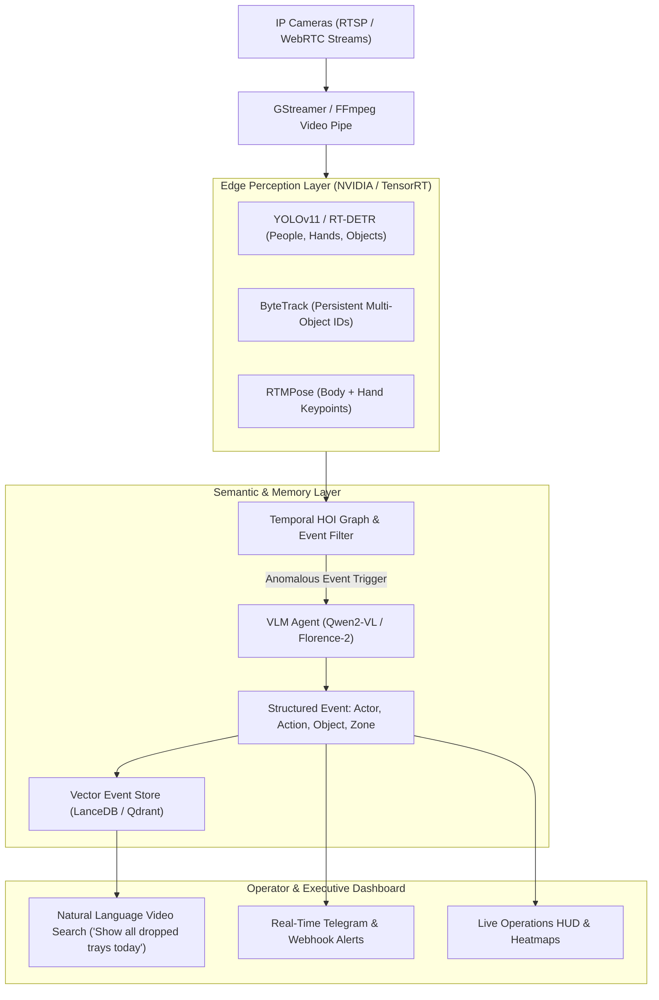

# Video Analytics & Action Recognition Platform — Research & Architecture

> **Author:** GAMBIT Autonomous Research  
> **Topic:** Real-Time Video Analytics, Human Activity Recognition (HAR), SOP Compliance & Semantic Visual Search  
> **Date:** 2026-10-23  

---

## 1. Paradigm Shift: From Rigid Classifiers to Vision-Language Video Agents

### Traditional Video Analytics (2019–2023): Rigid & Fragile
- **3D CNNs (SlowFast, I3D, X3D):** Required training custom neural networks with thousands of labeled video clips for every single action class (e.g. "sitting", "running", "falling").
- **Zero Extensibility:** If a business needed to check whether an employee wore surgical gloves, washed hands for 40 seconds, or took a phone out in a sterile room, it required weeks of dataset gathering and model retraining.

### Modern Frontier (2025–2026): Hybrid Edge Perception + Vision-Language Reasoning
- **Stage 1 (Sub-10ms Edge Stream Processing):** Lightweight edge tracking models (YOLOv11, RT-DETR, ByteTrack, RTMPose) extract high-frequency bounding boxes, persistent object IDs, and skeletal trajectories (17 body joints + 21 finger landmarks).
- **Stage 2 (Temporal Human-Object Interaction - HOI):** Aggregates motion vectors and proximity graphs: `[Person_ID=3] interacts with [Object="Medical Syringe"] in [Zone="Sterile Prep"]`.
- **Stage 3 (Vision-Language Reasoner - Qwen2-VL / InternVideo2 / Florence-2):** Translates video clips into semantic structured events on demand. Zero-shot natural language rule definitions:
  > *"Notify in Telegram if an operator touches raw food without washing hands first"*  
  > *"Flag any moment where a patient in waiting area shows distress or falls"*

---

## 2. High-Value Industry Scenarios & Innovative Ideas

### A. Medical & Dental Clinics (Direct Synergy with `dycom-demo`)
1. **Surgical Protocol & Sterility Compliance:**
   - **Hand-Washing Protocol:** Verification of WHO 6-step hand hygiene technique and mandatory 40-second scrub duration before entering the operatory.
   - **Personal Protective Equipment (PPE):** Verification of surgical masks, sterile gloves, eye shields, and gowns.
   - **Surgical Sponge & Instrument Count:** Real-time visual tracking of sponges, scalpels, and burs entering and leaving the sterile tray to prevent retained surgical bodies.
2. **Doctor Ergonomics & Fatigue Radar:**
   - Real-time 3D Pose Estimation tracking neck tilt (>35°), asymmetric shoulder drooping, and prolonged static posture during multi-hour implant surgery.
3. **Patient Safety & Care Telemetry:**
   - Automated fall detection (elderly patients in transit corridors).
   - Facial grimace / pain score estimation in the dental chair.

### B. Retail, Hospitality & Service Experience
1. **Customer Journey & Attention Tracking:**
   - Dwell time at key product displays without invasive facial recognition (tracking bounding boxes & gaze vectors).
   - Unattended customer alert: triggers manager notification if a customer waits at a service counter > 90 seconds without staff engagement.
2. **Loss Prevention & Scan Avoidance (Anti-Theft):**
   - **Sweethearting Detection:** Cashier pretending to scan an item while passing it over the barcode reader without optical registration.
   - **Concealment Detection:** Customer placing merchandise into pockets or backpacks (`Action: Pocketing item`).

### C. Industrial Manufacturing, Construction & Warehousing
1. **Standard Operating Procedure (SOP) Audit & Cycle Time Analysis:**
   - Decomposes worker tasks on assembly lines into granular micro-steps.
   - Automatically detects bottlenecks: why does Station 3 take 4.2 minutes instead of the standard 2.5 minutes?
2. **Geofenced Hazardous Zones & Heavy Machinery Collision Shield:**
   - Virtual safety envelope around robotic arms, forklifts, or overhead cranes. If a pedestrian enters the 2.5-meter exclusion zone, an immediate acoustic brake trigger is fired.

### D. Information Security & Smart Office
1. **Shoulder Surfing Detection:** Alerts developer/analyst when an unrecognized person stands behind them looking at a screen displaying sensitive code or customer PII.
2. **Screen Capture Guard:** Instant screen blanking and audit logging when a smartphone camera lens is pointed at a confidential workstation display.

---

## 3. Platform Architecture: "Argus-Vision"

---

## 4. Competitive Moats & GAMBIT Synergy

1. **Natural Language Search ("Google for Video Surveillance"):**
   Managers do not scrub 10 hours of CCTV footage. They type: *"Show me the moment when the blue toolbox went missing"* and receive the exact 10-second clip with confidence score.
2. **Synergy with `llmaas`:** `llmaas` provides the high-speed local inference serving for the Qwen2-VL reasoning layer and vector search embeddings.
3. **Synergy with `3DAang`:** 3D avatars can serve as interactive synthetic security agents delivering daily operational shift briefings and compliance summaries.
