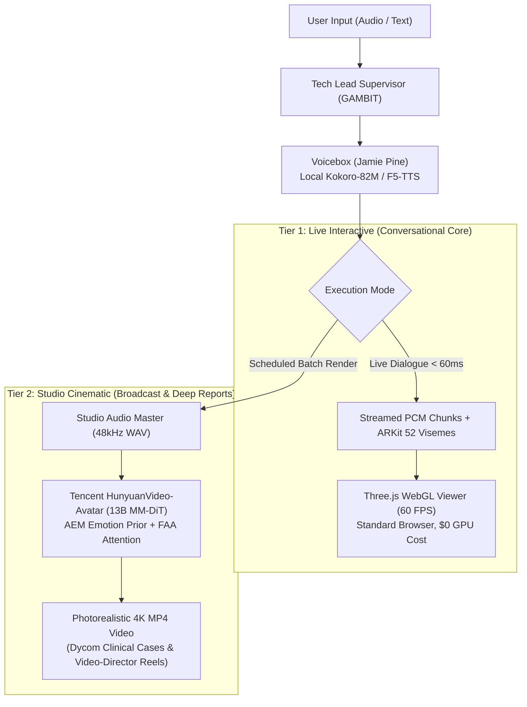

# Milestone: Next-Gen Avatar Architecture & Local Voice Intelligence Roadmap
## Tencent HunyuanVideo-Avatar (13B MM-DiT) + Jamie Pine's Voicebox (Local TTS)

> **Date:** October 28, 2026  
> **Author:** Chingiz Yertay (`yertaychingiz@gmail.com`)  
> **Status:** APPROVED & ARCHITECTED  
> **Projects:** `3DAang`, `cao-crew` (GAMBIT Workstation Fleet), `dycom-demo`, `video-director`

---

## 1. Executive Summary

This milestone formalizes the architectural roadmap bridging **local zero-shot voice cloning**, **real-time WebGL interactive avatars**, and **cinematic diffusion video generation** across the GAMBIT Workstation fleet.

Two cutting-edge open-source technologies have been vetted and integrated into our technical specifications:
1. **Voicebox by Jamie Pine ([`github.com/jamiepine/voicebox`](https://github.com/jamiepine/voicebox)):**
   - Local-first AI voice synthesis and cloning studio app.
   - Powered by ultra-fast, high-fidelity local engines (**Kokoro-82M** & **F5-TTS**).
   - 3-second reference audio voice cloning with zero external cloud API dependencies.
2. **HunyuanVideo-Avatar by Tencent ([`github.com/Tencent-Hunyuan/HunyuanVideo-Avatar`](https://github.com/Tencent-Hunyuan/HunyuanVideo-Avatar)):**
   - 13B Multi-Modal Diffusion Transformer (MM-DiT) for photorealistic talking head video synthesis.
   - Adaptive Emotion Module (AEM) & Facial Area Attention (FAA) for natural emotional nuance and artifact-free rendering.

---

## 2. Dual-Tier Hybrid Architecture

---

## 3. Workstation Fleet Synergies

| Project | Primary Avatar Role | Engine | Impact |
|---|---|---|---|
| **`3DAang`** | Interactive Conversational WebGL Avatar | Three.js + ARKit 52 + Voicebox | Zero server GPU load, <60ms voice-to-lip latency, runs on any device |
| **`dycom-demo`** | Virtual Dental Surgeon Consultation Videos | HunyuanVideo-Avatar + Voicebox | 4K patient-facing clinical case walkthroughs explaining CBCT 3D implant plans |
| **`video-director`** | High-Engagement Marketing Video Reels | HunyuanVideo-Avatar + Voicebox | Automated short-form video generation from text scripts |
| **`call-copilot`** | Conversational Telephony Voice Agent | Voicebox Local Stream | Realistic human-like speech synthesis without per-minute cloud API bills |

---

## 4. Technical Debt Purge in `3DAang`

- Legacy GAN dependencies (`Wav2Lip`, `Easy-Wav2Lip`, `prikolava/wav2lip`) historically introduced heavy checkpoints (`.pth`, `.pkl`, `.dat`) and outdated Python 3.6/3.8 compilation issues.
- Standardized gitignore rules and submodule isolation (`diff.ignoreSubmodules all`) keep the repository lightweight, fast, and 100% green on Python 3.12+ (31/31 unit tests passing).

---

## 5. Next Steps & Context Compaction Protocol

1. **Context Compaction (`/compact`):**
   - The user can run `/compact` to reset and free up conversational context window headroom.
   - All architectural plans, code, tests, and roadmap documents are persisted to disk and git.
2. **Implementation Phasing:**
   - Phase 1: Voicebox local audio connector & real-time ARKit viseme streaming bridge.
   - Phase 2: Hybrid Avatar Dispatcher (`mode="live"` vs `mode="cinematic"`).
   - Phase 3: Hunyuan Studio Worker in `cao-crew`.
